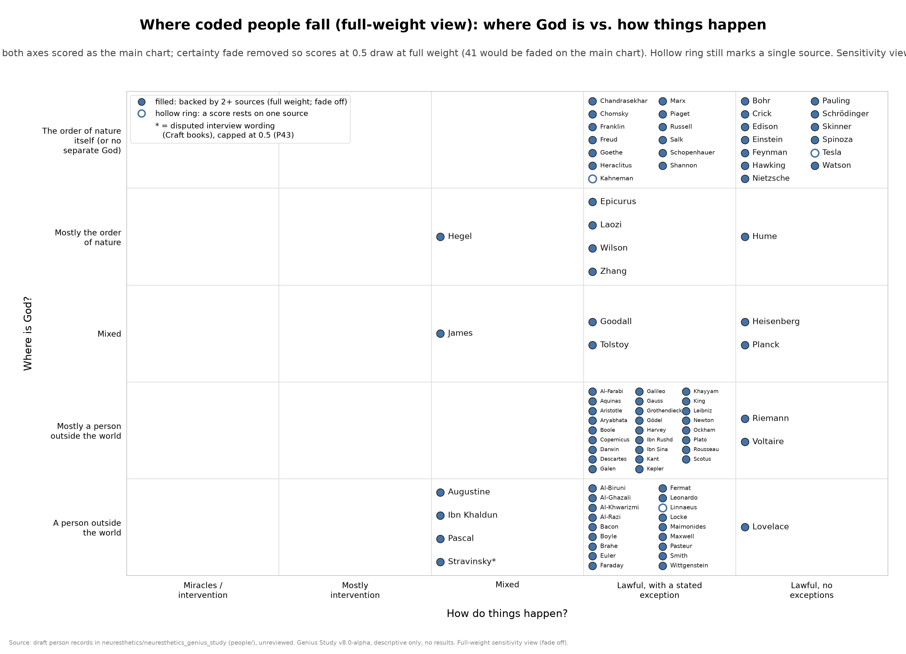

# Neuresthetics Genius Study

Where do the people history remembers as geniuses stand on God, nature and law?

This repo rebuilds that public record from sources, one person at a time. **Lane A** describes what each person's sources show about God and nature — every quote located, every score capped by source quality. **Lane B** is a separate, labeled belief: that learning lawful order early may pay off. Lane A never depends on Lane B, and Lane A never pays for it.

**Why bother:** most talk about genius and belief leans on anecdotes or summary labels. Here the awkward cases stay visible — unsettled axes, single-source scores, people who name a transcendent God and still describe nature as running on law. Five independent LLM lists also disagree a lot (966 of 1,380 roster people appear on only one list). That disagreement is part of the record.

**Study page:** [neuresthetics.github.io/study](https://neuresthetics.github.io/study/)

**There are no results yet.** Nothing here supports a frequency, rate or ranking claim. Drafts are unreviewed.

Releases and past versions are listed under [History](#history). The current prerelease tag is a scaffolding detail, not the name of the study.

## Progress status

<!-- BEGIN GENERATED: progress -->
<!-- Generated by scripts/progress_status.py; the Audits and Next steps rows are manual constants in that script. -->

| Item | Status |
|---|---|
| Roster people | 1,380: 441 core, 33 provisional, 17 review, 889 new names still need a status |
| People coded (of core) | 215 / 441 (draft, unreviewed) |
| Belief systems sourced | 66 / 77 (P46; plus 10 sourced, unscored; the rest are stubs) |
| Decisions settled | 65 / 65 |
| Audits | Early work: 9 blind lens runs on four claim packets — see [reports/audit_2026-10-02.md](reports/audit_2026-10-02.md). Stage 3 person batches and belief-system batches S1–S12 were each blind-audited with fixes applied. Rulings live in [docs/OPEN_DECISIONS.md](docs/OPEN_DECISIONS.md); batch-by-batch history is in [CHANGELOG.md](CHANGELOG.md). |
| Latest tag | `v8.0-alpha` (prerelease) |
| Next steps | Deepening of all 228 coded person files is done; P47–P50 darkness/hollow cues are applied; charts refreshed (88 plotted, 140 not scorable). Systems pass complete (66 sourced, 10 sourced but unscored, 1 stub). Roster frozen — no new people. Open for Jason (not blocking): Augustine mid_basin under P4; Linnaeus span end 1758 (RQ-Z5-N1). Revised rubric has not started. Details: [docs/OPEN_DECISIONS.md](docs/OPEN_DECISIONS.md), [CHANGELOG.md](CHANGELOG.md). |

<!-- END GENERATED: progress -->

The table is regenerated by `python3 scripts/progress_status.py` and checked with `--check`. The Audits and Next steps rows are kept by hand in that script.

## Figures

These charts describe what is in the repo so far; they are not results. No region is marked. Regenerate with `python3 scripts/make_figures.py`. The full-weight sensitivity view alone: `python3 scripts/make_figures.py --fullweight`.


*How many of the five LLM-generated lists name each of the 1,380 roster people (966 are on only one list), and each list's raw rows against the roster people it names.*


*Composition of the 441 core candidates by field bucket. Region of birth is coded per person record, so only coded people appear in the region panel. This describes the candidate roster, not a finding.*


<!-- BEGIN GENERATED: people_chart_caption -->
*Draft person scores: where God is (up the chart) against how things happen (across the chart). No region is marked. Plotted: the 88 coded people with both axes scored; every plotted person is B_cause 2, 3 or 4. Nobody plotted scores in the left two columns (miracles or intervention, or mostly intervention). **Interview voice (P43):** Igor Stravinsky (A 0, B 2) rests on interview statements of disputed wording (for Stravinsky, the Craft books), capped at 0.5 and drawn faded; 6 plotted people score left of B 3 (Augustine, Hegel, Ibn Khaldun, James, Pascal, Stravinsky). **Not scorable yet:** 140 coded people lack a score on at least one axis (40 with no A_locus score, 31 with no B_cause score, 69 with neither; the value is UNKNOWN or BELOW_THRESHOLD). They are not plotted and are left out of every count here. These are unreviewed, hand-picked drafts, not a sample, and there is no base rate for any era, so the chart shows only where these people fall, not a pattern or a rate. Each surname sits next to its dot. A faded dot is a less certain score (below 0.7 on at least one axis).*
<!-- END GENERATED: people_chart_caption -->

### Including weaker scores (sensitivity view)

The main person chart above fades any dot with certainty below 0.7, so you can see what rests on firmer ground. A second view draws the **same 88 people** at full weight — including the **42** whose best public evidence only clears 0.5 — while hollow rings still mark a single source.

That view is not a claim that weak evidence equals strong evidence. It is an illustration: the cloud of placements does not vanish when you stop visually discounting soft scores. It also marks a hard stop. Analysis is "enough" here when further reading would not move someone onto the grid or change a rule — only deepen a footnote. Complete coverage of every remembered genius is impossible; honest gaps are part of the work. Drafts only — no results yet. Lane A stays descriptive.



*Full-weight sensitivity view of the same 88 plotted people (42 would be faded on the main chart). Fade off; hollow = single source. Not a result. Regenerate with `python3 scripts/make_figures.py --fullweight`.*

### People not yet on the chart

The 140 coded people below are not on the chart because at least one axis has no settled score yet — either no public own-voice claim was found, or the best evidence never clears the bar. They are left out of every chart count. One line each; regenerate with `python3 scripts/progress_status.py`. Drafts only — no results yet.

<!-- BEGIN GENERATED: not_scorable -->
- **Ada Yonath** — Where God sits never clears the evidence bar; nature-side score is in place.
- **Akira Kurosawa** — Where God sits and how nature runs both never clear the evidence bar.
- **Alan Turing** — Where God sits never clears the evidence bar; nature-side score is in place.
- **Alexander Fleming** — No settled score for where God is; nature-side score is in place.
- **Alexander Graham Bell** — Where God sits never clears the evidence bar; no settled score for how nature runs.
- **Alfred North Whitehead** — Where God sits never clears the evidence bar; no settled score for how nature runs.
- **Amartya Sen** — No settled score for how nature runs; where-God score is in place.
- **Andreas Vesalius** — No settled score for where God is; nature-side score is in place.
- **Andrew Wiles** — No settled score for where God is; how nature runs never clears the evidence bar.
- **Antoine Lavoisier** — Where God sits never clears the evidence bar; nature-side score is in place.
- **Archimedes** — No settled score for where God is; nature-side score is in place.
- **Arnold Schoenberg** — Where God sits never clears the evidence bar; no settled score for how nature runs.
- **Barbara McClintock** — No settled score for where God is; nature-side score is in place.
- **Bill Gates** — Where God sits never clears the evidence bar; no settled score for how nature runs.
- **Brahmagupta** — Where God sits never clears the evidence bar; nature-side score is in place.
- **Caravaggio** — No settled score for where God is or how nature runs.
- **Carl Jung** — Where God sits never clears the evidence bar; nature-side score is in place.
- **Carl Sagan** — Where God sits never clears the evidence bar; nature-side score is in place.
- **Caroline Herschel** — How nature runs never clears the evidence bar; where-God score is in place.
- **Chien-Shiung Wu** — No settled score for where God is; nature-side score is in place.
- **Chinua Achebe** — Where God sits never clears the evidence bar; no settled score for how nature runs.
- **Claude Debussy** — Where God sits and how nature runs both never clear the evidence bar.
- **Claude Lévi-Strauss** — Where God sits never clears the evidence bar; no settled score for how nature runs.
- **Claude Monet** — Where God sits never clears the evidence bar; no settled score for how nature runs.
- **Confucius** — No settled score for how nature runs; where-God score is in place.
- **Dante Alighieri** — How nature runs never clears the evidence bar; where-God score is in place.
- **David Hilbert** — Where God sits never clears the evidence bar; nature-side score is in place.
- **Demis Hassabis** — Where God sits never clears the evidence bar; nature-side score is in place.
- **Dmitri Mendeleev** — Where God sits never clears the evidence bar; nature-side score is in place.
- **Donald Knuth** — No settled score for how nature runs; where-God score is in place.
- **Donatello** — No settled score for where God is or how nature runs.
- **Dorothy Hodgkin** — Where God sits never clears the evidence bar; nature-side score is in place.
- **Duke Ellington** — How nature runs never clears the evidence bar; where-God score is in place.
- **Edwin Hubble** — Where God sits never clears the evidence bar; nature-side score is in place.
- **Emmy Noether** — No settled score for where God is; nature-side score is in place.
- **Enrico Fermi** — Where God sits never clears the evidence bar; nature-side score is in place.
- **Euclid** — No settled score for where God is; nature-side score is in place.
- **Ferdinand de Saussure** — No settled score for where God is or how nature runs.
- **Frank Lloyd Wright** — No settled score for how nature runs; where-God score is in place.
- **Franz Kafka** — Where God sits and how nature runs both never clear the evidence bar.
- **Franz Schubert** — Where God sits never clears the evidence bar; no settled score for how nature runs.
- **Frida Kahlo** — Where God sits never clears the evidence bar; no settled score for how nature runs.
- **Fyodor Dostoevsky** — Where God sits never clears the evidence bar; no settled score for how nature runs.
- **Gabriel García Márquez** — Where God sits never clears the evidence bar; no settled score for how nature runs.
- **Geoffrey Chaucer** — No settled score for where God is or how nature runs.
- **Geoffrey Hinton** — No settled score for how nature runs; where-God score is in place.
- **George Orwell** — No settled score for how nature runs; where-God score is in place.
- **Georgia O'Keeffe** — Where God sits never clears the evidence bar; no settled score for how nature runs.
- **Grace Hopper** — No settled score for where God is or how nature runs.
- **Gregor Mendel** — No settled score for where God is; nature-side score is in place.
- **Grigori Perelman** — No settled score for where God is or how nature runs.
- **Guglielmo Marconi** — No settled score for how nature runs; where-God score is in place.
- **Hannah Arendt** — Where God sits never clears the evidence bar; no settled score for how nature runs.
- **Hedy Lamarr** — No settled score for where God is or how nature runs.
- **Henri Matisse** — Where God sits never clears the evidence bar; no settled score for how nature runs.
- **Henri Poincaré** — No settled score for where God is; nature-side score is in place.
- **Henrietta Swan Leavitt** — Where God sits never clears the evidence bar; nature-side score is in place.
- **Henry Ford** — No settled score for how nature runs; where-God score is in place.
- **Herbert Simon** — Where God sits never clears the evidence bar; nature-side score is in place.
- **Hippocrates** — No settled score for where God is; how nature runs never clears the evidence bar.
- **Homer** — No settled score for where God is or how nature runs.
- **Hypatia** — Where God sits never clears the evidence bar; no settled score for how nature runs.
- **Ibn al-Haytham (Alhazen)** — No settled score for where God is; nature-side score is in place.
- **Ibn Battuta** — No settled score for how nature runs; where-God score is in place.
- **Ivan Pavlov** — Where God sits never clears the evidence bar; nature-side score is in place.
- **J. Robert Oppenheimer** — Where God sits never clears the evidence bar; nature-side score is in place.
- **J.M.W. Turner** — Where God sits never clears the evidence bar; no settled score for how nature runs.
- **Jacques Derrida** — Where God sits never clears the evidence bar; no settled score for how nature runs.
- **James Joyce** — Where God sits never clears the evidence bar; no settled score for how nature runs.
- **Jane Austen** — How nature runs never clears the evidence bar; where-God score is in place.
- **Jean-Paul Sartre** — No settled score for how nature runs; where-God score is in place.
- **Johann Sebastian Bach** — Where God sits never clears the evidence bar; no settled score for how nature runs.
- **Johannes Brahms** — Where God sits never clears the evidence bar; no settled score for how nature runs.
- **Johannes Gutenberg** — No settled score for where God is or how nature runs.
- **John Maynard Keynes** — Where God sits never clears the evidence bar; no settled score for how nature runs.
- **John McCarthy** — No settled score for how nature runs; where-God score is in place.
- **John Milton** — No settled score for how nature runs; where-God score is in place.
- **John Nash** — No settled score for where God is or how nature runs.
- **John Stuart Mill** — Where God sits never clears the evidence bar; no settled score for how nature runs.
- **John von Neumann** — Where God sits never clears the evidence bar; nature-side score is in place.
- **Jorge Luis Borges** — Where God sits never clears the evidence bar; no settled score for how nature runs.
- **Joseph-Louis Lagrange** — No settled score for where God is; nature-side score is in place.
- **Judith Butler** — Where God sits never clears the evidence bar; no settled score for how nature runs.
- **Katherine Johnson** — No settled score for how nature runs; where-God score is in place.
- **Le Corbusier** — No settled score for where God is or how nature runs.
- **Lise Meitner** — Where God sits never clears the evidence bar; nature-side score is in place.
- **Ludwig Mies van der Rohe** — No settled score for where God is or how nature runs.
- **Ludwig van Beethoven** — How nature runs never clears the evidence bar; where-God score is in place.
- **Mahatma Gandhi** — Where God sits never clears the evidence bar; no settled score for how nature runs.
- **Marcel Proust** — Where God sits never clears the evidence bar; no settled score for how nature runs.
- **Marie Curie** — Where God sits never clears the evidence bar; nature-side score is in place.
- **Martin Heidegger** — Where God sits and how nature runs both never clear the evidence bar.
- **Marvin Minsky** — No settled score for how nature runs; where-God score is in place.
- **Mary Shelley** — Where God sits never clears the evidence bar; no settled score for how nature runs.
- **Maryam Mirzakhani** — No settled score for where God is or how nature runs.
- **Michel Foucault** — Where God sits and how nature runs both never clear the evidence bar.
- **Michelangelo** — No settled score for how nature runs; where-God score is in place.
- **Miguel de Cervantes** — Where God sits and how nature runs both never clear the evidence bar.
- **Miles Davis** — No settled score for where God is or how nature runs.
- **Milton Friedman** — Where God sits never clears the evidence bar; no settled score for how nature runs.
- **Nelson Mandela** — No settled score for how nature runs; where-God score is in place.
- **Niccolò Machiavelli** — Where God sits and how nature runs both never clear the evidence bar.
- **Pablo Picasso** — Where God sits never clears the evidence bar; no settled score for how nature runs.
- **Parmenides** — No settled score for where God is or how nature runs.
- **Paul Cézanne** — No settled score for how nature runs; where-God score is in place.
- **Paul Dirac** — Where God sits never clears the evidence bar; nature-side score is in place.
- **Paul Samuelson** — No settled score for where God is or how nature runs.
- **Plotinus** — Where God sits never clears the evidence bar; nature-side score is in place.
- **Pyotr Ilyich Tchaikovsky** — Where God sits never clears the evidence bar; no settled score for how nature runs.
- **Pythagoras** — Where God sits and how nature runs both never clear the evidence bar.
- **Rachel Carson** — Where God sits never clears the evidence bar; no settled score for how nature runs.
- **Raphael** — No settled score for where God is or how nature runs.
- **Rembrandt** — No settled score for where God is or how nature runs.
- **Richard Wagner** — Where God sits never clears the evidence bar; nature-side score is in place.
- **Robert Koch** — No settled score for where God is; nature-side score is in place.
- **Roger Penrose** — Where God sits never clears the evidence bar; nature-side score is in place.
- **Rudolf Clausius** — No settled score for where God is; nature-side score is in place.
- **Rumi** — Where God sits and how nature runs both never clear the evidence bar.
- **Salvador Dalí** — No settled score for where God is or how nature runs.
- **Samuel Morse** — How nature runs never clears the evidence bar; where-God score is in place.
- **Siddhartha Gautama** — Where God sits and how nature runs both never clear the evidence bar.
- **Simone de Beauvoir** — No settled score for how nature runs; where-God score is in place.
- **Socrates** — No settled score for how nature runs; where-God score is in place.
- **Srinivasa Ramanujan** — Where God sits and how nature runs both never clear the evidence bar.
- **Steve Jobs** — Where God sits never clears the evidence bar; no settled score for how nature runs.
- **Sun Tzu** — No settled score for where God is; how nature runs never clears the evidence bar.
- **Sushruta** — No settled score for where God is; how nature runs never clears the evidence bar.
- **Søren Kierkegaard** — How nature runs never clears the evidence bar; where-God score is in place.
- **Terence Tao** — No settled score for where God is; nature-side score is in place.
- **Tim Berners-Lee** — No settled score for how nature runs; where-God score is in place.
- **Toni Morrison** — How nature runs never clears the evidence bar; where-God score is in place.
- **Vera Rubin** — No settled score for where God is; nature-side score is in place.
- **Vincent van Gogh** — No settled score for how nature runs; where-God score is in place.
- **Vint Cerf** — No settled score for where God is; nature-side score is in place.
- **Virgil** — Where God sits and how nature runs both never clear the evidence bar.
- **Virginia Woolf** — No settled score for how nature runs; where-God score is in place.
- **Willard Libby** — No settled score for where God is; nature-side score is in place.
- **William Shakespeare** — No settled score for where God is or how nature runs.
- **Wolfgang Amadeus Mozart** — How nature runs never clears the evidence bar; where-God score is in place.
- **Évariste Galois** — No settled score for where God is or how nature runs.
<!-- END GENERATED: not_scorable -->


*Draft belief-system scores (unreviewed). The grid shows systems with both axes settled. The left strip holds systems whose "how things happen" axis is not settled, placed at their "where God is" row. The bottom strip holds systems whose "where God is" axis is not settled, placed at their "how things happen" column. The box lists systems with neither axis settled. Faded means capped at 0.5. Positions are each system's own stance, not an average of its members.*


*The same chart with the hand-picked people added (circles). These are drafts, not a sample and not a result.*


*The 66 sourced belief-system drafts (P46) on the five LIO axes, showing each score with its certainty. These are unreviewed coder drafts, not the v7.1 rubric, and the other 11 systems are a stub (1, 4THWAY) or sourced but unscored (10).*

## Method in short

Compared with the earlier complete release ([v7.1](https://github.com/neuresthetics/neuresthetics_v7)):

- The genius roster is rebuilt from the five original model lists. It now has 1,380 people (up from 482).
- Frequency (F) is the number of distinct models that list a person (1 to 5); alias counts are not added together.
- Each person and each belief system gets its own record, with sources and a certainty grade for every fact.
- Coding scales and lists that were left open earlier (LIO axes, era buckets, regions, and related rules) are now set. Settled decisions are in [open decisions](docs/OPEN_DECISIONS.md); see [CHANGELOG.md](CHANGELOG.md) for the trail.

## Repo layout

| Path | What's there |
| :--- | :--- |
| `data/sources/` | Raw inputs, read-only, with checksums: the five model lists and the v7.1 combined JSON. |
| `data/roster/` | Roster (`roster.csv`), alias map, merge log, hand-curated merges, and person ids. |
| `people/` | One Markdown file per person, `people/<first letter>/<id>.md`. |
| `systems/` | One Markdown file per belief system (77), named by the v7.1 code. |
| `schema/` | JSON Schemas for person and system records. |
| `templates/` | Blank person and system records to copy. |
| `scripts/` | Roster rebuild, id assignment, validators, coverage report, data dictionary generator, figures, README progress table. |
| `docs/` | Method, data dictionary, coding guide, runbook, open decisions. |
| `reports/` | Generated reports (coverage). |
| `figures/` | Descriptive charts made by `scripts/make_figures.py` (no results). |
| `versions/` | Per-version notes and roster diffs. |
| `papers/` | Papers, once written. |

## How the database grows

One person per run. Each run picks the next person, researches them from primary and scholarly sources, fills their record (leaving `TODO` where nothing is sourced yet), validates it, and commits. Belief-system records are extended the same way. Michael Faraday (`people/f/faraday-michael.md`) and Pantheism (`systems/PANT.md`) are the worked examples.

```bash
pip install -r scripts/requirements.txt
python3 scripts/rebuild_roster.py --check   # roster reproduces from the raw lists
python3 scripts/assign_ids.py --check       # person ids are up to date
python3 scripts/validate_people.py          # person records
python3 scripts/validate_systems.py         # belief-system records
python3 scripts/coverage_report.py          # writes reports/coverage.md
python3 scripts/progress_status.py --check  # README progress table is up to date
pip install -r scripts/requirements-figures.txt
python3 scripts/make_figures.py             # writes figures/*.png
```

## Docs

- [Method](docs/METHOD.md): how the roster, ids and records are built, and why.
- [Data dictionary](docs/DATA_DICTIONARY.md): every file, column and field.
- [Coding guide](docs/CODING_GUIDE.md): coding rules, certainty, worldview codes, LIO axes, and system records.
- [Runbook](docs/RUNBOOK.md): step by step for one person (or system) per run.
- [Open decisions](docs/OPEN_DECISIONS.md): choices that need sign-off and what was decided.
- [Coverage](reports/coverage.md): what exists so far.
- [Period rule sensitivity](reports/period_rule_sensitivity.md): 55 coded values would change if evidence from outside a person's working years were set aside instead of counted.

## History

Past versions stay in their own repos so their history doesn't change. Tags and prereleases for the current rebuild live on this repo's [Releases](https://github.com/neuresthetics/neuresthetics_genius_study/releases) page (including the scaffolding prerelease).

> **Content warning: everything before V7.** V5 and V6 use methods that are now retired, including V6's ranking of religions by dividing counts of historical geniuses by 2025 religious population figures. Their results are not findings, and they compare specific faiths in ways the current study no longer does. They're kept only so the path to the current method stays visible.

| Version | Where | Notes |
| :--- | :--- | :--- |
| V5 | [V5 PDF](https://github.com/neuresthetics/neuresthetics_v7/blob/main/V6_(history)/V5/Genius%20Data%20Analysis%20V5%20(as%20dev%20history%20only).pdf) | Content warning. Dev history only. |
| V6 | [NEUR-V6-DATA](https://github.com/neuresthetics/NEUR-V6-DATA) | Content warning. Retired rate-table approach. |
| V7 / V7.1 | [neuresthetics_v7](https://github.com/neuresthetics/neuresthetics_v7) | Two-lane paper, neurology sister paper, data book, combined JSON. Latest complete release until a new one is published. |

## Site

[neuresthetic.net](https://neuresthetic.net) · [Study page](https://neuresthetics.github.io/study/)
