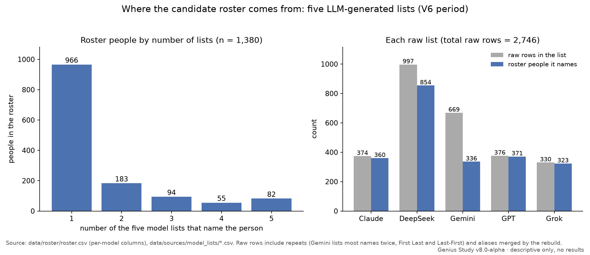
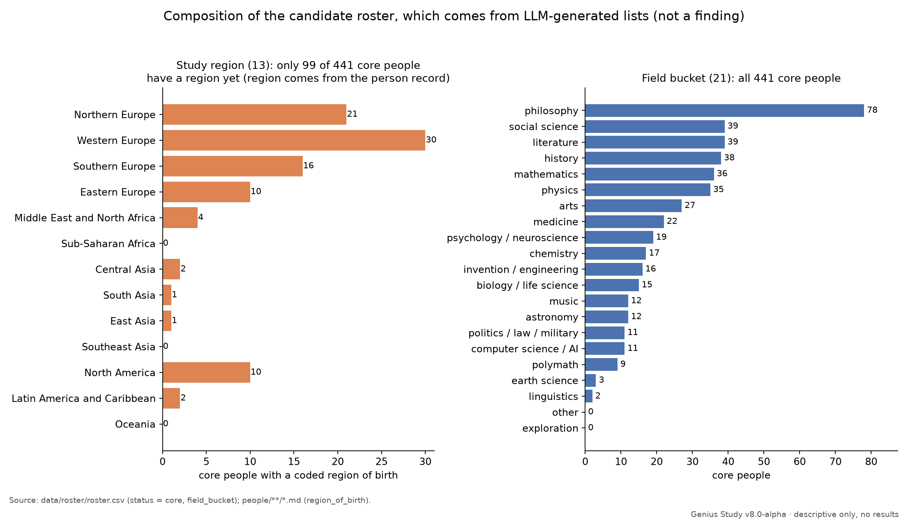
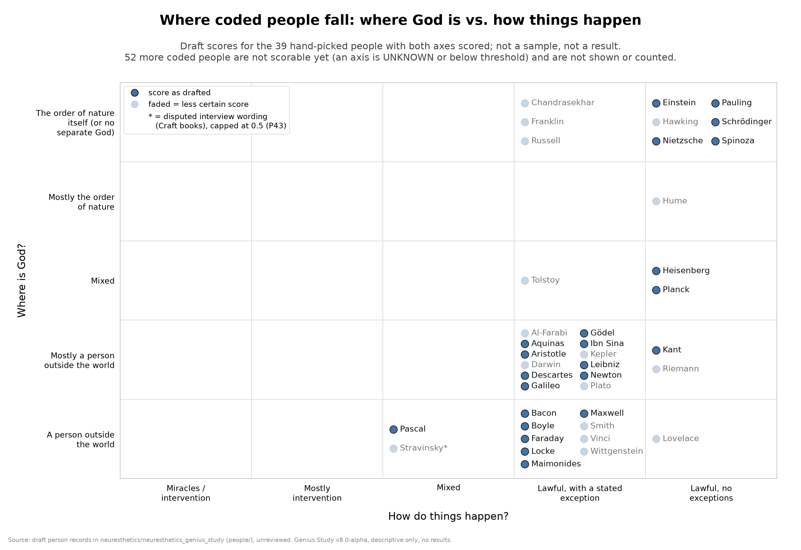
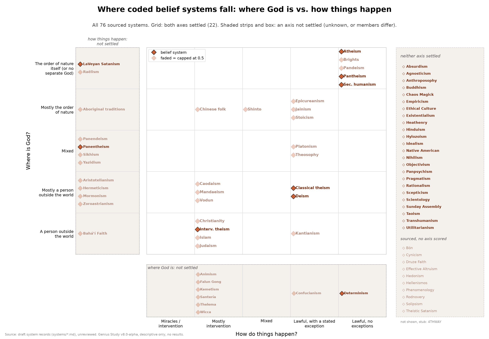
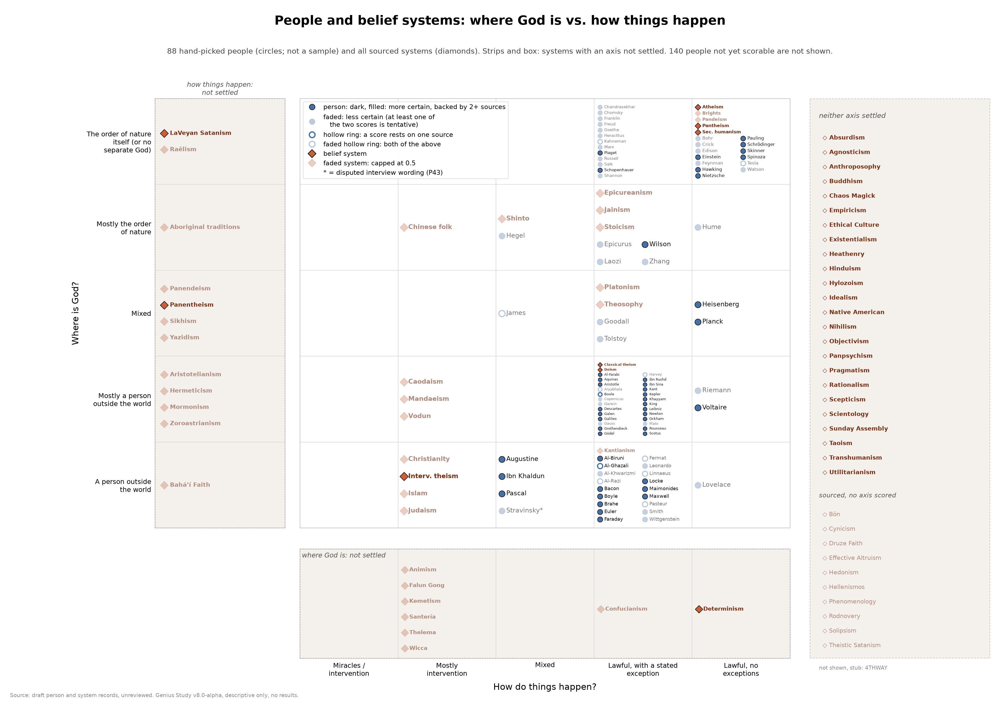
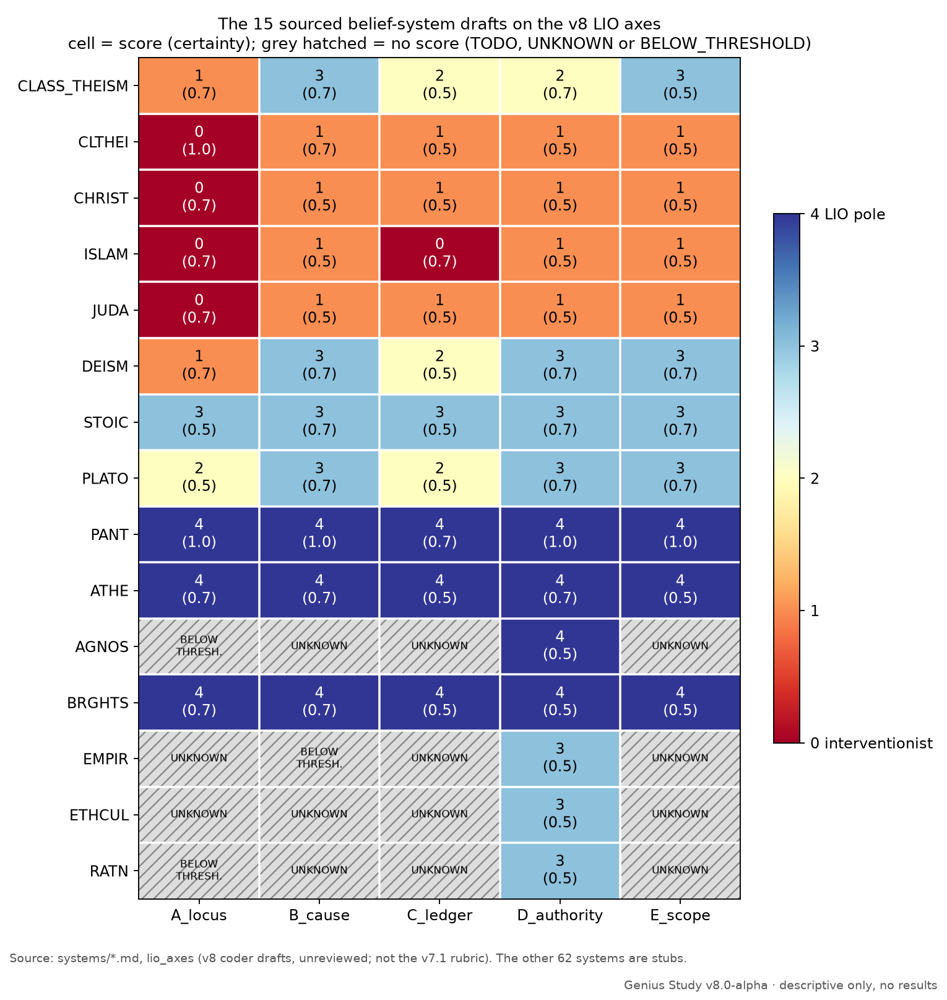

# Neuresthetics Genius Study

A study of where remembered genius sits on a scale of lawful, non-intervening order, plus a labeled belief model of how learning that order early might pay off. All versions live here. The version number is a detail, not the name.


**Current version:** v8 (in progress). The [v8.0-alpha prerelease](https://github.com/neuresthetics/neuresthetics_genius_study/releases/tag/v8.0-alpha) has the scaffolding and draft records, but no results. Until v8 is published, the latest complete release is [v7.1](https://github.com/neuresthetics/neuresthetics_v7).

**Study page:** [neuresthetics.github.io/study](https://neuresthetics.github.io/study/)

## Progress status

**There are no results yet.** Nothing here supports a frequency, rate or ranking claim.

<!-- BEGIN GENERATED: progress -->
<!-- Generated by scripts/progress_status.py; the Audits and Next steps rows are manual constants in that script. -->

| Item | Status |
|---|---|
| Roster people | 1,380: 441 core, 33 provisional, 17 review, 889 new names still need a status |
| People coded (of core) | 103 / 441 (draft, unreviewed) |
| Belief systems sourced | 66 / 77 (P46; plus 10 sourced, unscored; the rest are stubs) |
| Decisions settled | 61 / 61 |
| Audits | 9 blind lens runs on four batches: 3 on a 115-claim packet (eff4700), 2 on a 147-claim packet (e648145), 2 on a 124-claim packet (d9903b7/43cecc4; fixes at 6f37cd6) and 2 on a 165-claim packet (b21655b; run 1 155 hold / 10 weaken, run 2 160 hold / 5 weaken, 0 wrong; agreement 156/165, κ 0.37; fixes applied at 3bcd59c); see [reports/audit_2026-10-02.md](reports/audit_2026-10-02.md). Stage 3: 4 blind runs on the first 12 records (stage 3-a: 561 claims at 59a8371; stage 3-b: 420 claims at 3db6511); their method rulings are decisions P14–P28; one blind run on the stage 3-b rulings (93 claims at 6155174: 88 hold, 4 weaken, 1 fail, fixed at 4c10399) gave P29; lens's runs on the v8.a rulings packet (34a73c4) and the v8.b P29 packet (e930597) gave P30; the P30 span-alignment audit (7a52a3f) gave P31; one blind run on stage 3 batch C (14 claims at dd91009: 8 hold, 6 weaken, 0 fail; no second run needed under P30 #16) gave P35 and P36; one blind run on batch D (16 claims at 3f4817e: 14 hold, 2 weaken, 0 fail) gave P41, and one on batch E (18 claims at 2332880: 17 hold, 1 weaken, 0 fail); their fixes are applied; one on batch F (15 claims at 64605bd: 15 hold, 0 weaken, 0 fail) passed; its fixes are applied; one on batch G (13 claims at 5ff29b4: 13 hold, 0 weaken, 0 fail) passed and gave P43 (v8's ruling on RQ1 (on the auditor's advice)); its fixes are applied. Batch H (Marx, Tolstoy, Leonardo da Vinci, Beethoven; 7 claims at cae9cb2: 6 hold, 1 weaken, 0 fail) passed and extended P41 to miracle rejection; its fixes are applied; batch I (Wittgenstein, Maimonides, Michelangelo, Tesla; 10 claims at bbb26f8: 8 hold, 2 weaken, 0 fail) passed; its fixes are applied; batch J (Omar Khayyam, Picasso, Plato, Raphael; 13 claims at 81b9098: 10 hold, 3 weaken, 0 fail) passed; its fixes are applied; batch K (Rembrandt, Rosalind Franklin, Salvador Dalí, Simone de Beauvoir; 10 claims at 2d75649: 9 hold, 1 weaken, 0 fail) passed; its fixes are applied; batch L (Socrates, Stephen Hawking, Thomas Edison, Tim Berners-Lee; 11 claims at 2742382: 10 hold, 1 weaken, 0 fail) passed; its fixes are applied at 55d6956; all of batches H–L have passed their audits with fixes applied; batch M (Vincent van Gogh, Virginia Woolf, William Shakespeare, Wolfgang Amadeus Mozart; 19 claims at 159d60d: 16 hold, 3 weaken, 0 fail) passed; its fixes are applied, and v8's ruling on its RQ1 (on the auditor's advice) added the P42 will-preamble addendum |
| Latest tag | `v8.0-alpha` (prerelease) |
| Next steps | Stage 3 (everyone else with F ≥ 3) has started: the first 12 records (Spinoza, Descartes, Pascal, Leibniz, Kant, Hume, Darwin, Gauss, Riemann, Turing, Noether, von Neumann) are drafts that still need to apply P29 and P30 (the stage 3-b six follow P14–P28 on main; the stage 3-a six also still need P14–P28); the other 79 records follow P14–P28 (schema 1.3) and P30's age rule, and their worldview.working_years now equals timing.major_work_period (P30 addendum); under P31 (continuity rule) all 55 values the span audit flagged stand; the strict-period alternative is in reports/period_rule_sensitivity.md; batch C (Wu, Lovelace, Smith, al-Farabi, al-Khwarizmi, Bell) is drafted in P32 order and its blind lens run is applied (P35, P36); batch D (Archimedes, Aristotle, McClintock, Russell, Debussy, Monet) is drafted and its blind audit is applied (P41); batch E (Dante, Euclid, Francis Bacon, Kahlo, Nietzsche, Dostoevsky) is drafted (P40) and its blind audit is applied; batch F (García Márquez, Hopper, Arendt, Poincaré, Hippocrates, Homer) is drafted (P42) and passed its blind audit (15/15 hold; fixes applied); batch G (Hypatia, Stravinsky, Bach, Locke) is drafted (P43) and passed its blind audit (13/13 hold; fixes applied); batch H (Marx, Tolstoy, Leonardo da Vinci, Beethoven) passed its blind audit (6 hold, 1 weaken; fixed); batch I (Wittgenstein, Maimonides, Michelangelo, Tesla) passed its blind audit (8 hold, 2 weaken; fixed); batch J (Omar Khayyam, Picasso, Plato, Raphael) passed its blind audit (10 hold, 3 weaken; fixed); batch K (Rembrandt, Rosalind Franklin, Salvador Dalí, Simone de Beauvoir) passed its blind audit (9 hold, 1 weaken; fixed); batch L (Socrates, Stephen Hawking, Thomas Edison, Tim Berners-Lee) passed its blind audit (10 hold, 1 weaken; fixed); batch M (Vincent van Gogh, Virginia Woolf, William Shakespeare, Wolfgang Amadeus Mozart) passed its blind audit (16 hold, 3 weaken; fixed; RQ1 gave the P42 will-preamble addendum); batch N (Andrew Wiles, Arthur Schopenhauer, B.F. Skinner, Carl Jung) is drafted and out for its blind audit; batch O (Carl Sagan, Claude Shannon, Confucius, David Hilbert) is drafted and awaits its blind audit; next in order Donald Knuth, Francis Crick, Franz Kafka, Galen; systems were sourced in batches of six in v7.1 number order (S1 passed its blind audit, 5 hold, 2 weaken; fixed under P44; S2 passed its blind audit, 9 hold, 1 weaken; fixed; S3 passed its blind audit, 10 hold, 1 weaken; fixed; S4 passed its blind audit, 11 hold, 1 weaken; fixed; S5 passed its blind audit, 13/13 hold; follow-ups applied; S6 passed its blind audit, 14 hold, 1 weaken; fixed; S7 passed its blind audit, 13 hold, 3 weaken; fixed (P44(e)); S8 passed audit with fixes (SHINTO B, HINDU C, HELLEN and KEMET re-sourced under P45(a)); S9 passed audit with fixes (RODNOV A and BON A, B to UNKNOWN; P46 added); S10 passed audit with fixes (VODUN scope, ANTHRO D 1, quote-backed P46 checks); S11 passed audit with fixes (THEOS B 3; summary-only sources are leads); S12 passed audit with fixes (P45(b) amended; RAEL stays sourced). Systems pass complete: all 77 worked in batches S1–S12, every batch blind-audited with fixes applied; 66 sourced, 10 sourced but unscored (P46), 1 stub (4THWAY, until a full text is read)); the revised rubric has not started |

<!-- END GENERATED: progress -->

The table is regenerated by `python scripts/progress_status.py` and checked with `--check`. The Audits and Next steps rows are kept by hand in that script.

### Figures (v8.0-alpha, descriptive only)

These charts describe what is in the repo so far; they are not results. The roster comes from five LLM-generated lists, and the person chart shows the coded draft (unreviewed) records; no region is marked. Regenerate them with `python scripts/make_figures.py`.



*How many of the five LLM-generated lists name each of the 1,380 roster people (966 are on only one list), and each list's raw rows against the roster people it names.*



*Composition of the 441 core candidates by field bucket. Region of birth is coded per person record, so only coded people appear in the region panel. This describes the candidate roster, not a finding.*



<!-- BEGIN GENERATED: people_chart_caption -->
*Draft person scores: where God is (up the chart) against how things happen (across the chart). No region is marked. Plotted: the 42 coded people with both axes scored; every plotted person is B_cause 2, 3 or 4. Nobody plotted scores in the left two columns (miracles or intervention, or mostly intervention). **Interview voice (P43):** Igor Stravinsky (A 0, B 2) rests on interview statements of disputed wording (for Stravinsky, the Craft books), capped at 0.5 and drawn faded; 2 plotted people score left of B 3 (Pascal, Stravinsky). **Not scorable yet:** 61 coded people lack a score on at least one axis (24 with no A_locus score, 10 with no B_cause score, 27 with neither; the value is UNKNOWN or BELOW_THRESHOLD). They are not plotted and are left out of every count here. These are unreviewed, hand-picked drafts, not a sample, and there is no base rate for any era, so the chart shows only where these people fall, not a pattern or a rate. Each surname sits next to its dot. A faded dot is a less certain score (below 0.7 on at least one axis).*
<!-- END GENERATED: people_chart_caption -->



*Draft belief-system scores (unreviewed). The grid shows systems with both axes settled. The left strip holds systems whose "how things happen" axis is not settled, placed at their "where God is" row. The bottom strip holds systems whose "where God is" axis is not settled, placed at their "how things happen" column. The box lists systems with neither axis settled. Faded means capped at 0.5. Positions are each system's own stance, not an average of its members.*



*The same chart with the hand-picked people added (circles). These are drafts, not a sample and not a result.*



*The 66 sourced belief-system drafts (P46) on the five v8 LIO axes, showing each score with its certainty. These are unreviewed coder drafts, not the v7.1 rubric, and the other 11 systems are a stub (1, 4THWAY) or sourced but unscored (10).*

## What changes in v8

v8 starts by fixing the data in v7.1:

- The genius roster is rebuilt from the five original model lists, which v7.1 didn't fully use. It now has 1,380 people, up from 482.
- Frequency (F) is now the number of distinct models that list a person (1 to 5), so alias counts no longer get added together.
- Each person and each belief system gets its own record, with sources and a certainty grade for every fact.
- The two belief systems that were both labeled "Classical Theism" get separate display names (approved).
- The scales and lists that v7.1 left open (LIO axis scale, era buckets, regions and the other coding rules) are now set. All 61 decisions are settled: 19 on 2026-10-01, P6–P31 and S7 on 2026-10-02, P32–P37 on 2026-10-08, and P38–P45 on 2026-10-15. P9, P11–P33, P35, P36, P38–P42, P44, P45 and S7 are v8's picks on method details Jason delegated (P14–P30 came from the stage 3 lens audits and the lens runs on their rulings; P31 from the span-alignment audit; P32–P33 from stage 3 batch C, P35–P36 from its lens audit; P38–P39 from stage 3 batch D, P40 from batch E, P41 from the batch D audit, extended by the batch H audit to non-scientists who reject miracles or intervention, P42 from batch F, P44 from the systems batch S1 audit (P44(d) from the S6 audit, P44(e) from the S7 audit), P45 from the S4 audit); P34, P37 and P43 are Jason's own rulings (P43 from the batch G audit); P42's addendum on formulaic will preambles is v8's pick on the batch M auditor's advice; P8 and P10 began as v8's picks and Jason has signed them off ([open decisions](docs/OPEN_DECISIONS.md)).

See [CHANGELOG.md](CHANGELOG.md) for details.

## Repo layout

| Path | What's there |
| :--- | :--- |
| `data/sources/` | Raw inputs, read-only, with checksums: the five model lists and the v7.1 combined JSON. |
| `data/roster/` | The v8 roster (`roster.csv`), alias map, merge log, hand-curated merges, and person ids. |
| `people/` | One Markdown file per person, `people/<first letter>/<id>.md`. |
| `systems/` | One Markdown file per belief system (77), named by the v7.1 code. |
| `schema/` | JSON Schemas for person and system records. |
| `templates/` | Blank person and system records to copy. |
| `scripts/` | Roster rebuild, id assignment, validators, coverage report, data dictionary generator, figures, README progress table. |
| `docs/` | Method, data dictionary, coding guide, runbook, open decisions. |
| `reports/` | Generated reports (coverage). |
| `figures/` | Descriptive charts made by `scripts/make_figures.py` (no results). |
| `versions/` | Per-version notes and the v7.1 → v8 roster diff. |
| `papers/` | v8 papers, once written. |

## How the database grows

One person per run. Each run picks the next person, researches them from primary and scholarly sources, fills their record (leaving `TODO` where nothing is sourced yet), validates it, and commits. Belief-system records are extended the same way. Michael Faraday (`people/f/faraday-michael.md`) and Pantheism (`systems/PANT.md`) are the worked examples.

```bash
pip install -r scripts/requirements.txt
python3 scripts/rebuild_roster.py --check   # roster reproduces from the raw lists
python3 scripts/assign_ids.py --check       # person ids are up to date
python scripts/validate_people.py           # person records
python scripts/validate_systems.py          # belief-system records
python scripts/coverage_report.py           # writes reports/coverage.md
python scripts/progress_status.py --check   # README progress table is up to date
pip install -r scripts/requirements-figures.txt
python scripts/make_figures.py              # writes figures/*.png
```

## Docs

- [Method](docs/METHOD.md): how the roster, ids and records are built, and why.
- [Data dictionary](docs/DATA_DICTIONARY.md): every file, column and field.
- [Coding guide](docs/CODING_GUIDE.md): the v7.1 coding rules, certainty, worldview codes, LIO axes, and system records.
- [Runbook](docs/RUNBOOK.md): step by step for one person (or system) per run.
- [Open decisions](docs/OPEN_DECISIONS.md): choices that need sign-off and what was decided (none open as of 2026-10-15).
- [Coverage](reports/coverage.md): what exists so far.
- [Period rule sensitivity](reports/period_rule_sensitivity.md): 55 coded values would change if evidence from outside a person's working years were set aside instead of counted.

## History

Past versions stay in their own repos so their history doesn't change.

> **Content warning: everything before V7.** V5 and V6 use methods that are now retired, including V6's ranking of religions by dividing counts of historical geniuses by 2025 religious population figures. Their results are not findings, and they compare specific faiths in ways the current study no longer does. They're kept only so the path to the current method stays visible.

| Version | Where | Notes |
| :--- | :--- | :--- |
| V5 | [V5 PDF](https://github.com/neuresthetics/neuresthetics_v7/blob/main/V6_(history)/V5/Genius%20Data%20Analysis%20V5%20(as%20dev%20history%20only).pdf) | Content warning. Dev history only. |
| V6 | [NEUR-V6-DATA](https://github.com/neuresthetics/NEUR-V6-DATA) | Content warning. Retired rate-table approach. |
| V7 / V7.1 | [neuresthetics_v7](https://github.com/neuresthetics/neuresthetics_v7) | Two-lane paper, neurology sister paper, data book, combined JSON. |

## Site

[neuresthetic.net](https://neuresthetic.net)
